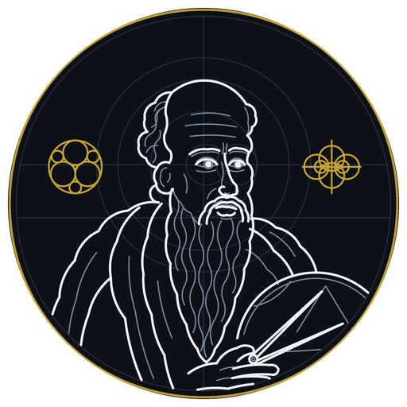

<a href="https://geometor.github.io/apollonius/"></a>

# GEOMETOR • apollonius

**Visit the Online Archive:** https://geometor.github.io/apollonius/

<p align="center">
  <a href="https://geometor.github.io/apollonius/"></a>
</p>

**Apollonius of Perga • Conics, Reconstructed Analytic Works • semantic digital archive**

## Mission

`geometor/apollonius` is part of the interconnected [GEOMETOR](https://geometor.com) semantic digital archive. It provides a multi-track Book Codex, interactive vector diagram atlas, and proposition concordance of Apollonius of Perga's monumental treatise on conic sections and reconstructed analytic works. The archive liberates the classical Greek and Arabic texts from isolated print bounds into addressable semantic units, calibrated theme-adaptive vector diagrams, primary-source concordance provenance, and exact symbolic connections across the GEOMETOR corpus.

## Books in This Archive

- [Conics](https://geometor.github.io/apollonius/conics/) — Books I–VII (ed. Sir Thomas Little Heath, 1896), establishing the generation of conics from an oblique cone, diameters, asymptotes, harmonic poles and polars, and normals as extrema.
- [Reconstructed Analytic Works](https://geometor.github.io/apollonius/reconstructed/) — Reconstructions of Apollonius's lost analytic treasury preserved in Pappus of Alexandria's *Synagoge* Book VII, including the Problem of Apollonius (*Tangencies*) and *Determinate Section*.

## Repository Contents

- `docsrc/` — Multi-track Book Codex, apparatus, and Sphinx documentation compiled by [PHOTON publish](https://github.com/photon-platform/publish).
- `resources/` — Concordance registries, mappings across classical proposition systems, and symbolic gap audits.
- `src/geometor/apollonius/` — Python modules for proposition cross-referencing, diagram generation, and symbolic analysis.

## Local Build & Verification

```bash
publish build
uv run --no-sync pytest
```
## Part of the GEOMETOR Knowledge Archive

Explore all **74 Book Codices** and **11 Mathematical Catalogs** at https://geometor.com/books/.
