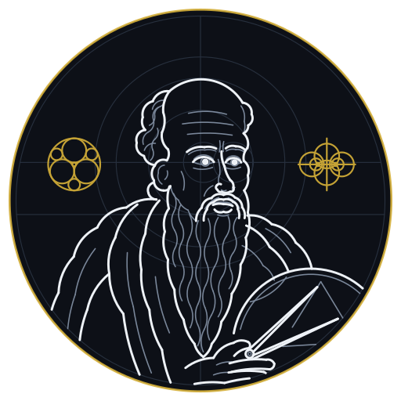

:site_title: Apollonius of Perga

.. _apollonius-home:

.. container:: author-overline

   semantic digital archive • the works of

===================
Apollonius of Perga
===================

:person:`Apollonius of Perga <apollonius>` (*The Great Geometer*, c. 262 – c. 190 BCE) transformed classical geometry by deriving the parabola, ellipse, hyperbola, and opposite branches from a single oblique cone. This archive unites Sir Thomas Little Heath's critical edition of the seven surviving books of the *Conics* with reconstructions of Apollonius's six lost analytic treatises preserved by Pappus of Alexandria, paired with calibrated vector figures and cross-edition concordances.

Works in This Archive
---------------------

.. container:: home-book-hero

   .. container:: home-book-thumb

      .. image:: _static/figures/fig_oblique_cone_sections.svg
         :alt: Parabola, ellipse, and hyperbola cut from a single oblique cone
         :target: conics/index.html

   .. container:: home-book-body

      .. rubric:: Heath Critical Edition · 1896 · Books I–VII · 147 Propositions

      **Conics (*Κωνικά*)** — Apollonius's masterwork on second-degree curves, spanning cone sections, diameters and asymptotes, harmonic poles and polars, central foci, normals and evolutes, congruence and similarity, and the conjugate-diameter theorems.

      .. container:: home-actions

         * :doc:`Open the Conics → <conics/index>`
         * :doc:`Preface & Letters → <conics/preface/index>`
         * :doc:`Start at Book I → <conics/book_01/index>`

.. container:: home-book-hero

   .. container:: home-book-thumb

      .. image:: _static/figures/fig_problem_of_apollonius_ccc.svg
         :alt: Problem of Apollonius — circle tangent to three given circles
         :target: reconstructed/index.html

   .. container:: home-book-body

      .. rubric:: Domain of Analysis · Pappus Synagoge VII · 6 Lost Treatises

      **Reconstructed Analytic Works** — Restorations of Apollonius's six two-book treatises from the ancient *Treasury of Analysis*: *Cutting Off of a Ratio*, *Cutting Off of an Area*, *Determinate Section*, *Tangencies* (*CCC*), *Inclinations* (*Neusis*), and *Plane Loci*.

      .. container:: home-actions

         * :doc:`Open Reconstructed Works → <reconstructed/index>`
         * :doc:`On Tangencies (CCC) → <reconstructed/sec_01_tangencies/index>`
         * :doc:`Plane Loci → <reconstructed/sec_02_plane_loci/index>`

Key Features
------------

.. container:: home-feature-grid

   .. container:: home-feature-card

      **12 Calibrated Vector Plates**

      Interactive geometric diagrams trace oblique cone cuts, application of areas, harmonic polars, the evolute of normals, the *Circle of Apollonius*, and the eight-solution *CCC* tangency problem.

   .. container:: home-feature-card

      **Arabic & Greek Witness Concordance**

      Follow every theorem across Heiberg's Greek text (Books I–IV), Thābit ibn Qurra and Halley's Arabic-Latin tradition (Books V–VII), and Heath's consolidated numbering in the :doc:`Concordance <conics/concordance>`.

   .. container:: home-feature-card

      **Multi-Track Commentary & Apparatus**

      Switch seamlessly between Heath's modernized English text, editorial **Summary** syntheses, and primary-source **Notes** tied directly to 1896 folio pages.

Reference & Project
-------------------

.. container:: home-columns

   .. container:: home-col

      .. rubric:: Scholarly Apparatus

      * :doc:`People <conics/people/index>` — Apollonius, Menaechmus, Euclid, Archimedes, Eutocius, Pappus, Halley, Heiberg, and Heath
      * :doc:`Concordance <conics/concordance>` & :doc:`Bibliography <conics/bibliography>` — Proposition cross-reference and critical sources
      * :doc:`Glossary <conics/glossary>` — Greek conic terminology (*parabole*, *elleipsis*, *hyperbole*, *diorismos*)

   .. container:: home-col

      .. rubric:: About This Project

      * :doc:`About <about/index>` — Scope, sources, and connection to GEOMETOR
      * :doc:`Using This Edition <usage/index>` — Reading guide, track switching, and diagram controls
      * :doc:`Modules <modules/index>` — Python package reference and verification utilities

.. toctree::
   :hidden:
   :maxdepth: 2

   conics/index
   reconstructed/index
   conics/people/index
   conics/bibliography
   usage/index
   about/index
   modules/index

